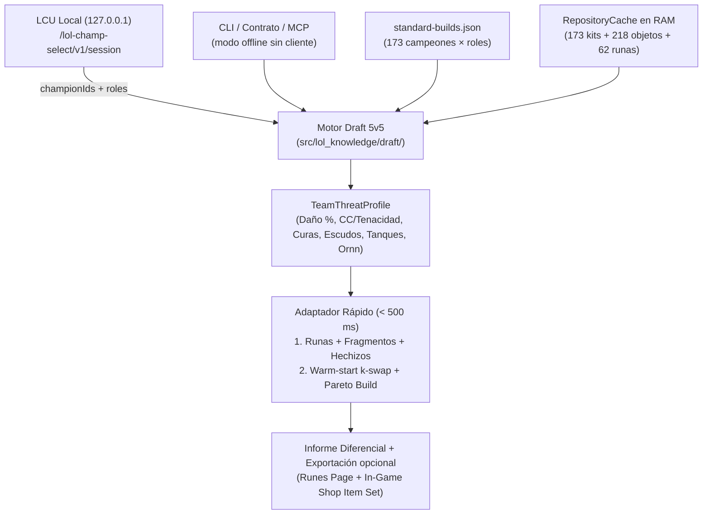

# Fase `v2.0` — Asistente Determinista de Selección de Campeones (`Champ Select Assistant`)

- **Versión objetivo:** `2.0.0`
- **Estado:** Planificada — pendiente de implementación
- **Prerrequisitos:** Serie `1.x` completada hasta `v1.6.0` (`RepositoryCache`, `crit_mode="expected"`, `identity.py`, `pareto.py` y cobertura `173/173` en `dev`)
- **Rama sugerida:** `feat/v2-0-champ-select-assistant` *(o sub-ramas integradas en orden `2.0-A` → `2.0-D`)*
- **Hoja de ruta:** [`../roadmap-v2.md`](../roadmap-v2.md) (`DEC-07`, `STD-01`, `DRAFT-01..03`, `LCU-01..02`)
- **Modo de ejecución recomendado:** **Orchestrator en 4 sub-paquetes desacoplados** (`standard/`, `draft/threat_model.py`, `draft/optimizer.py` y `lcu/`), seguido de integración en CLI/Contrato/MCP y revisión dedicada de seguridad y cumplimiento Riot.

---

## 1. Visión de producto y restricción crítica de tiempo real (`DEC-07`)

La **`v2.0.0`** transforma `LoL-Knowledge` de una calculadora de escenarios manuales en un **Asistente Determinista de Selección de Campeones**:

- **Escenario real de uso:** cuando el último jugador del equipo enemigo fija su campeón en Selección de Campeones (*Champ Select*), el jugador dispone de **entre `25` segundos (peor caso) y `50` segundos (mejor caso)** antes de que se bloqueen definitivamente las runas, los fragmentos y los hechizos de invocador y comience la carga de la partida.
- **Presupuesto estricto de latencia:** una vez conocido el 5.º campeón enemigo, el motor debe calcular y presentar la recomendación completa (Página de Runas + 3 Fragmentos + 2 Hechizos + Build Estándar vs. Build Adaptada + Orden de compra + Alertas tácticas) en **`< 500 ms` (`0,5 s`)**, sin depender de llamadas a un LLM en el camino crítico.
- **Ventaja diferencial frente a webs de estadísticas:** mientras las webs muestran una única build promedio estática, `LoL-Knowledge v2.0` parte de la **Build Estándar del campeón/rol** y utiliza los **kits mecánicos exactos de los 5 rivales y tus 4 aliados** para calcular matemáticamente cuándo cambiar botas, runas, penetración, *Heridas graves*, *Rompeescudos* o *QSS*, y cuándo **no** caer en trampas (como comprar *Botas de mercurio* contra un equipo de puros levantamientos `airborne`).

---

## 2. Guardarraíles legales, de seguridad y de políticas de Riot Games (`Innegociables`)

1. **Nueva etiqueta de conocimiento para builds base (`DEC-07`):**
   - Añadir `Label.STANDARD_BASE` (`Base recomendada`) o campo separado `baseline_source` para las builds estándar por `(campeón, rol)`, manteniéndola **estrictamente separada** de `Oficial`, `Derivado` y `Calculado` ([`AGENTS.md`](../../AGENTS.md) §6). Toda adaptación evaluada por el motor produce cifras `Calculado` con trazabilidad completa del delta respecto a la build estándar.
2. **Prohibido el scraping no autorizado ([`AGENTS.md`](../../AGENTS.md) §10):**
   - **Prohibido** raspar con bots HTML/endpoints internos de `u.gg`, `op.gg` u otros portales que lo prohíban en sus ToS o empleen bloqueos anti-bot.
   - Fuentes legítimas admitidas para generar `lol-knowledge/derived/standard-builds.json`:
     1. **Fuente primaria offline (`Derivado` del cliente):** extracción desde los archivos `.wad` del cliente instalado de Riot de las recomendaciones oficiales por campeón y posición (*Recommended Item Sets* y páginas de runas recomendadas por Riot, actualizadas cada parche con datos globales reales).
     2. **Fuente opcional oficial (`Riot Match-V5`):** script opcional bajo demanda en `research/tools/` que use una `RIOT_API_KEY` en variable de entorno (nunca versionada, `.env` ignorado) contra endpoints oficiales de Riot Developer Portal.
     3. **Respaldo determinista (`Calculado`):** generación offline con `optimize` (`v1.6`) frente a un equipo de referencia equilibrado cuando un par `(campeón, posición)` carezca de datos recomendados.
3. **Cumplimiento estricto con Riot Games en la LCU API (`Anti-Abuse` por diseño):**
   - Conexión **exclusivamente local** a `https://127.0.0.1:<port>` leyendo el `lockfile` del cliente local en memoria (sin guardar nunca el token temporal de sesión en disco ni en logs; [`AGENTS.md`](../../AGENTS.md) §9–§10).
   - **Prohibición absoluta de *Lobby Revealer*:** el parser de `/lol-champ-select/v1/session` **descarta e ignora en origen** `summonerId`, `puuid`, `gameName` y cualquier identificador personal de aliados o enemigos; solo lee `championId`, `assignedPosition`, `spell1Id`, `spell2Id` y el estado del temporizador (`phase`, `timeLeftInPhase`).
   - **Prohibición de automatización competitiva:** nunca acepta partida automáticamente, nunca banea ni fija campeón (*no instalock*) y nunca interactúa con el cliente durante la partida activa. La exportación de página de runas (`PUT /lol-perks/v1/currentpage`) o de conjunto de objetos para la tienda (`ItemSets`) solo se ejecuta con confirmación o bandera explícita del usuario (`--apply-runes`, `--export-item-set`).
   - **Cero red en `tests/`:** todas las pruebas de LCU y Champ Select usan payloads JSON grabados/sintéticos en `tests/fixtures/lcu/`.

---

## 3. Arquitectura modular en 4 subfases (`2.0-A` → `2.0-D`)



### Subfase `2.0-A` — Catálogo de Builds y Runas Estándar (`src/lol_knowledge/standard/`)
1. Definir esquema `lol-standard-builds/1` en `lol-knowledge/derived/standard-builds.json` validado por `lol_knowledge validate`:
   - Indexado por `champion_id` y rol (`TOP`, `JUNGLE`, `MIDDLE`, `BOTTOM`, `UTILITY`).
   - Contiene: `core_items` (3 objetos), `full_build` (6 objetos legales `OBJ-13`, incluyendo botas), `situational_pool` (objetos frecuentes del arquetipo), `rune_page` (6 runas legales `RUN-04`), `shards` (3 fragmentos), `summoners` (2 hechizos), `skill_max_order` (`Q/W/E`), `source` y `patch`.
2. Implementar extractor repetible en `research/binmodel/` (integrado en `research/tools/refresh_patch.py`) para regenerarlo en cada parche junto con la validación de legalidad de las `173` entradas.

### Subfase `2.0-B` — Modelo Mecánico de Amenazas `5v5` (`src/lol_knowledge/draft/threat_model.py`)
Dado `my_champion`, `my_role`, `allies: Sequence[DraftPick]` (`0..4`) y `enemies: Sequence[DraftPick]` (`1..5`), calcular en `< 50 ms` un `TeamThreatProfile` determinista evaluando los kits enemigos equipados con sus respectivas builds estándar a niveles `9`, `13` y `16`:
1. **Asignación determinista de roles enemigos (cuando el draft no informa roles rivales):** resolver la biyección de máxima verosimilitud entre los `1..5` campeones enemigos y `{TOP, JUNGLE, MIDDLE, BOTTOM, UTILITY}` según los roles registrados en `standard-builds.json` (permitiendo override manual `--enemy-roles` y declarando la asignación como supuesto explícito).
2. **Reparto exacto de daño enemigo:** porcentajes ponderados `physical_share`, `magic_share`, `true_share` y bandera `percent_health_true_threat` (`Vayne`, `Fiora`, `Camille`, `Gwen`).
3. **Auditoría exacta de Control de Masas (`CCAudit`):**
   - Suma de duraciones base y frecuencia de CC enemigo separada en:
     - `tenacity_reducible_seconds` (`stun`, `root`, `fear`, `charm`, `taunt`, `sleep`, `polymorph`, `silence`).
     - `airborne_seconds` (inmune a tenacidad y a *Limpiar*).
     - `suppression_sources` (`Malzahar R`, `Warwick R`, `Skarner R` — inmune a tenacidad y a *Limpiar*, limpiable con QSS).
   - **Regla anti-trampa:** calcular los segundos reales de bloqueo ahorrados por `30 %` de tenacidad (*Botas de mercurio*). Si el ahorro total frente a la composición enemiga es `< 0,35 s` porque predomina `airborne` o daño físico de ataques, emitir alerta explícita desaconsejando *Botas de mercurio*.
4. **Índices de Curación, Escudos, Tanques y Aliados:**
   - `enemy_healing_index`: cuantifica curaciones de kit + objetos de los 5 rivales → determina si *Heridas graves* supera el coste de oportunidad y en qué slot (`componente temprano` vs `3.º–4.º objeto` vs `innecesario`).
   - `enemy_shield_index`: cuantifica escudos enemigos → evalúa rentabilidad de *Colmillo de serpiente* (`6695`) en campeones de AD/letalidad.
   - `frontline_profile`: distingue acumuladores de vida (`DrMundo`, `Sion`, `Cho'Gath`, `TahmKench`) frente a acumuladores de armadura/RM (`Rammus`, `Malphite`, `Ornn`, `K'Sante`).
   - `ally_synergies`: activa automáticamente `ornn_upgrade=True` si `Ornn` está en `allies`, y pondera reparto de daño de tu propio equipo (ej. si tu equipo es `4 AD`, los rivales apilarán armadura → mayor valor marginal de penetración `%` o daño mágico/híbrido).

### Subfase `2.0-C` — Optimizador Rápido de Draft (`< 500 ms`) (`src/lol_knowledge/draft/optimizer.py`)
1. **Paso A — Selección de Runas, Fragmentos y Hechizos de Invocador (`< 80 ms`):**
   - Tomar la página estándar de `(my_champion, my_role)` y evaluar variaciones legales en los slots adaptativos:
     - Contra tu par de línea previsto (`lane_opponent` del mismo rol): comparar supervivencia/intercambio a nivel `3` y `6` (*Revestimiento de huesos* `8473` vs *Fuerzas renovadas* `8444`, fragmento de vida plana `5011` vs escalado `5001` vs tenacidad `5013`).
     - Contra el `TeamThreatProfile` global: *Golpe de gracia* (`8014`) vs *Corte* (`8017`), *Inquebrantable* (`8242`), *Leyenda: Presteza* vs *Linaje*, y recomendación de 2.º hechizo (*Limpiar* solo si hay CC limpiable de alto riesgo, *Extenuación* contra asesinos cuerpo a cuerpo/ráfaga, *Barrera*/*Curar*/*Teleportar*).
2. **Paso B — Adaptación de Build desde Semilla Estándar (`< 350 ms`):**
   - Función objetivo compuesta de partida (`MatchScore`): combina desempeño en fase de línea (nv. `9`, `1`–`2` objetos contra `lane_opponent`) y desempeño en pelea grupal (nv. `14`–`16`, `3`–`6` objetos evaluando supervivencia frente al perfil de ráfaga enemigo + DPS/utilidad frente al frente y objetivos prioritarios enemigos).
   - Partiendo de `standard_build`, ejecutar búsqueda local guiada (*1-swap* y *2-swap* con candidatos prefiltrados por el `TeamThreatProfile` + elección óptima de botas + curva de compra `OPT-04`) y filtro de Pareto para garantizar que `adapted_build` nunca sea dominada por `standard_build`.
3. **Paso C — Informe Diferencial Trazable (`DraftRecommendation`):**
   - Devuelve `standard_build`, `adapted_build`, `purchase_order`, `situational_branches` (máximo 3 reglas `Si ocurre X → sustituye A por B`), `recommended_runes`, `recommended_summoners`, `cc_and_tenacity_verdict` y `deltas` cuantificados en números exactos con sus etiquetas.
4. **Superficies offline y para IA:**
   - Subcomando CLI `python -m lol_knowledge draft --champion Zeri --role bottom --allies Nautilus,Orianna,JarvanIV,Ornn --enemies Malphite,Zac,Zed,Caitlyn,Leona` (funciona **sin cliente abierto**, ideal para pruebas, teoría y MCP).
   - Operación `"draft"` en `lol-knowledge-contract/1` (`contract.py`) y herramienta `lol_draft` en `mcp_server.py`.

### Subfase `2.0-D` — Conector Local LCU en Vivo y Exportación al Cliente (`src/lol_knowledge/lcu/`)
1. **`lcu/lockfile.py` y `lcu/client.py`:**
   - Localización segura del `lockfile` de League of Legends (rutas estándar en Windows/macOS o `--lockfile` / `--install-dir`), cliente HTTPS local sobre `urllib` + `ssl` (`127.0.0.1` exclusivamente) con *timeouts* estrictos (`<= 1,5 s`), manejo limpio de desconexión cuando el cliente está cerrado y cero exposición de credenciales en excepciones o logs.
2. **`lcu/champ_select.py` y subcomando `python -m lol_knowledge champ-select`:**
   - Precarga al arrancar todo `RepositoryCache` y `standard-builds.json` en RAM (`~150 ms` una sola vez al iniciar el asistente).
   - Vigila `/lol-champ-select/v1/session` con actualización incremental solo cuando cambia el conjunto `(my_champion, my_role, allies_locked, enemies_locked)`:
     - Muestra previsualización parcial conforme van saliendo picks rivales (`1/5`..`4/5`).
     - En el instante en que se fija el `5/5` enemigo (ventana de `25–50 s`), emite la recomendación definitiva en **`< 500 ms`**.
3. **`lcu/exporter.py` (acciones opcionales bajo bandera explícita del usuario):**
   - `--apply-runes`: crea o actualiza una página llamada `LoL-Knowledge [Auto]` vía LCU (`lol-perks/v1`) con validación previa `RUN-04`.
   - `--export-item-set`: genera el conjunto de objetos personalizado para el campeón activo con 3 bloques claros en la tienda del juego (*1. Salida y Núcleo Adaptado*, *2. Alternativa Estándar*, *3. Respuestas Situacionales de esta Partida*).
4. Actualizar [`README.md`](../../README.md), [`lol-knowledge/INDEX.md`](../../lol-knowledge/INDEX.md), [`lol-knowledge/ai-layer.md`](../../lol-knowledge/ai-layer.md), crear `lol-knowledge/champ-select.md` y elevar `__version__` a `"2.0.0"`.

---

## 4. Validaciones obligatorias y criterios de salida (`Definición de terminado`)

```powershell
.\.venv\Scripts\python.exe -m pytest -q
.\.venv\Scripts\python.exe -m pytest research/tests -q
.\.venv\Scripts\python.exe -m ruff check .
.\.venv\Scripts\python.exe -m ruff format --check .
.\.venv\Scripts\python.exe -m lol_knowledge validate
.\.venv\Scripts\python.exe research\tools\benchmark_engine.py --include-draft
```

- [ ] **Latencia garantizada en tests de rendimiento:** con `RepositoryCache` caliente, `evaluate_draft` completo (`5v5`: runas + fragmentos + hechizos + build adaptada + curva de compra + alertas) termina en **`< 500 ms`** (dejando `> 24,5 s` libres en el peor caso de `25 s` de Champ Select).
- [ ] **Tests de inteligencia táctica `5v5`:**
  - Contra `Malphite + Zac + Yasuo + Caitlyn + Alistar` (`airborne` dominante + mayoría física), el motor desaconseja *Botas de mercurio* y prioriza defensa física / penetración.
  - Contra `Malzahar` o `Warwick` + `Skarner`, detecta `suppression`, advierte que *Limpiar* no libera la supresión y añade *Fajín de mercurio* (`3140`) en respuestas situacionales/adaptadas.
  - Contra `Aatrox + Soraka + DrMundo`, dispara recomendación temprana cuantificada de *Heridas graves*.
  - Con `Ornn` aliado, activa automáticamente la mejora de obra maestra óptima.
- [ ] **Tests de privacidad/seguridad LCU:** verificar con fixtures reales anonimizados de `/lol-champ-select/v1/session` que ningún `summonerId`, `puuid`, nombre de jugador ni token del `lockfile` aparece jamás en estructuras internas, salidas JSON, texto ni logs.
- [ ] Integrado en `integration`, validado con toda la suite y promovido con `--ff-only` a `dev` como **`v2.0.0`** (sin `push` hasta autorización expresa del usuario).
